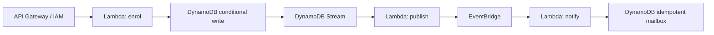

# TypeScript AWS Serverless Starter

A focused reference from [Rehan Akbar](https://www.rehanakbar.dev/templates), MIT licensed. Node.js 22+.

## Run without AWS

```sh
npm ci
npm test
npm run dev:local
```

POST http://127.0.0.1:5081/enrollments with Content-Type application/json and {"courseId":"11111111-1111-4111-8111-111111111111","studentId":"22222222-2222-4222-8222-222222222222"}. Expect 201 and an enrolment id; repeating the request returns 200 and the same id. GET /notifications/ID returns {"effects":1}. GET /health identifies local-memory mode.

Local adapters demonstrate the application contract. They are not an AWS emulator and lose all data on restart. Restart to reset. No AWS account, cloud resources, email provider or Docker is used in local mode.

## AWS design



An enrolment item is also the stream's durable publication source. Duplicate requests use a stable event identity and a conditional put. The stream publisher reports failed sequence numbers and checks EventBridge FailedEntryCount, so rejected publication is retried. The consumer's conditional mailbox insert is the business effect and idempotency record. This does not prove exactly-once external email delivery.

Partial batch reporting does not mean only the listed failed records are replayed: Lambda checkpoints at the lowest failed sequence number and can replay subsequent successful records too. The consumer must remain idempotent. See [AWS checkpoint semantics](https://docs.aws.amazon.com/lambda/latest/dg/services-ddb-batchfailurereporting.html).

## Optional deployment — creates billable resources

Install AWS SAM CLI and configure an authorised AWS profile. Review template.yaml, permissions, region, quotas and costs first.

```sh
sam validate --lint
sam build
sam deploy --guided
# When finished:
sam delete --stack-name YOUR_STACK_NAME
```

The API requires AWS IAM-signed requests. DynamoDB, Lambda, API Gateway, EventBridge, SQS and logging can incur charges; no zero-cost claim is made. Stream failures go to an encrypted SQS queue; consumer asynchronous failures use the same queue. Monitor and reconcile it. Review EventBridge target-delivery failures separately. sam delete removes the stack and its demonstration table; export any data you need first. Nothing deploys automatically in this repository.

For DynamoDB stream failures, the SQS destination contains invocation/stream metadata, not a durable copy of the original records. Stream retention can expire before an operator replays them. Recover enrolment payloads from the retained `ENROLLMENT#...` table items, reconcile against notification items, and republish deliberately; this repository does not implement that reconciliation tool. Do not treat the failure queue as a complete event archive. See [AWS failure-destination behavior](https://docs.aws.amazon.com/lambda/latest/dg/services-dynamodb-errors.html). Local tests and a loadable Lambda bundle are verified; a real AWS deployment has not been performed.

## Limitations / security

This flow validates identifiers and bounded request bodies, sanitises HTTP errors, uses parameterised SDK commands and resource-scoped application permissions. Course existence/capacity, tenant authorisation, rate limits, business authentication beyond IAM, notification-provider reconciliation and operational alarms are outside this reference. A mailbox row is not an email. Stream retention and retry limits mean a failed-delivery queue needs operational attention. Never commit AWS credentials. Dependency versions and npm lockfile are committed.

## Code formatting

Run `npm run format` to apply Prettier, or `npm run format:check` to verify. CI checks formatting before tests. Configuration and the formatter version are committed.
